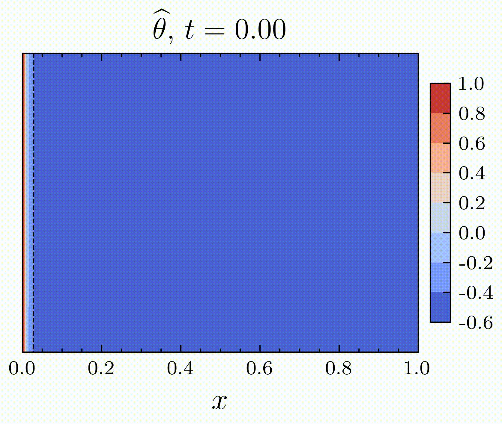
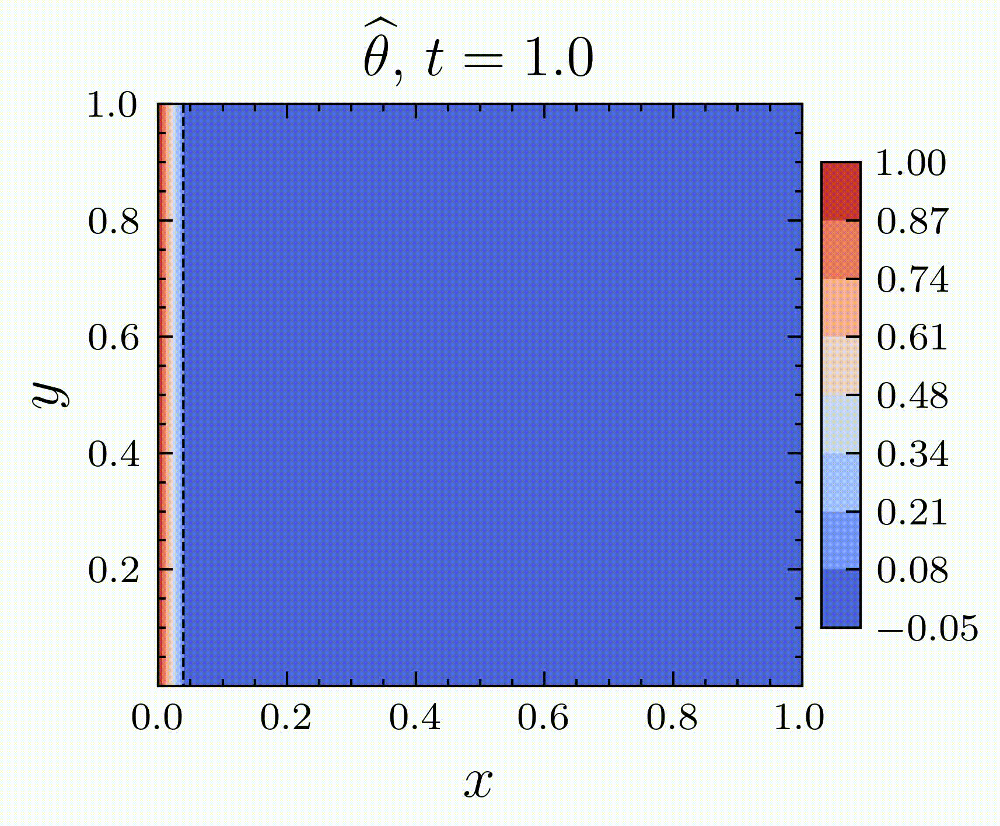

## Postdoctoral Research (2026 – Present)

- **With:** [Francky Luddens](https://luddens.perso.math.cnrs.fr/), [Simon Bernard](https://smnbrnrd.github.io/home).
- **At:** LMRS, University of Rouen Normandy.

My current research focuses on scientific machine learning approaches for approximating solutions to parameter-dependent PDEs over a range of parameter values, without solving the equations separately for each parameter configuration. The goal is to leverage these approaches to address inverse problems and optimize phase-change materials.

## Doctoral Research (2022–2026)

- **With:** [Ionut Danaila](http://ionut.danaila.perso.math.cnrs.fr/), [Francky Luddens](https://luddens.perso.math.cnrs.fr/), [Corentin Lothodé](https://lothode.pages.math.cnrs.fr/pageperso/).
- **At:** LMRS, University of Rouen Normandy.

Physics-Informed Neural Networks (PINNs) have emerged as a promising approach for solving partial differential equations (PDEs) by incorporating physical laws into the neural network training process [[RPK19]](https://faculty.sites.iastate.edu/hliu/files/inline-files/PINN_RPK_2019_1.pdf). My doctoral research investigated the application of PINNs to fluid flow and liquid–solid phase-change problems, with a particular focus on two classes of problems.

#### *Heat Conduction with Phase Change*

The Stefan problem describes heat conduction in materials undergoing a phase transition, where the liquid–solid interface evolves over time according to energy conservation. In this formulation, fluid motion and convective heat transfer are neglected.

::: {.columns}

::: {.column width="55%"}

The temperature $\theta$ satisfies the heat equation in each phase (liquid and solid) 
$$
\frac{\partial \theta_j}{\partial t} = \mathrm{Fo} \, \nabla^2 \theta_j,
\qquad j \in \{l,s\},
$$
while the motion of the liquid–solid interface $s(t)$ is governed by the Stefan condition:
$$
\frac{\partial \theta_s}{\partial n}
- \frac{\partial \theta_l}{\partial n} = \frac{s'(t)}{\mathrm{Fo} \, \mathrm{Ste}},
\qquad x = s(t).
$$

Here, $\mathrm{Fo}$ and $\mathrm{Ste}$ are the Fourier and Stefan numbers.
:::

::: {.column width="45%"}

{width=90%}

*Temperature prediction for the one-dimensional Stefan problem.*

:::

:::

#### *Liquid–Solid Systems with Phase Change*

Unlike the Stefan problem, this problem accounts for fluid motion and natural convection during melting and solidification. The governing equations couple *the incompressible Navier–Stokes equations* with heat transfer and phase change through an enthalpy–porosity approach.

::: {.columns}

::: {.column width="55%"}

The velocity field $\mathbf{u}$, pressure $p$, and temperature $\theta$ satisfy the following system:

$$
\begin{aligned}
\nabla \cdot \mathbf{u} &= 0, \\[1ex]
\frac{\partial \mathbf{u}}{\partial t}
+ (\mathbf{u}\cdot\nabla)\mathbf{u}
+ \nabla p
- \frac{1}{\mathrm{Re}}\nabla^2 \mathbf{u}
- F(\theta)\,\vec{\mathbf{e}}
- A(\theta)\,\mathbf{u} &= 0, \\[1.2ex]
\frac{\partial \theta}{\partial t}
+ (\mathbf{u}\cdot\nabla)\theta
- \frac{1}{\mathrm{Re}\,\mathrm{Pr}}\nabla^2 \theta
+ \frac{1}{\mathrm{Ste}}
\frac{\partial \varphi_\delta(\theta)}{\partial t} &= 0.
\end{aligned}
$$

Here, $\mathrm{Re}$, $\mathrm{Pr}$, and $\mathrm{Ste}$ denote the Reynolds, Prandtl, and Stefan numbers, respectively. The terms $F(\theta)$ and $A(\theta)$ represent buoyancy and solid-phase penalization, while $\varphi_\delta(\theta)$ describes the regularized liquid fraction.

:::

::: {.column width="45%"}

{width=120%}

*Temperature evolution during melting with natural convection.*

:::

:::

The main difficulty in solving these problems lies in the moving liquid–solid interface, which introduces regularity issues and makes the solution challenging to approximate using neural networks. My thesis investigates these difficulties and explores different approaches to address them within the PINN framework.

The full PhD thesis can be downloaded [here](https://theses.fr/2026NORMR024).

## Publications

::: {#refs}
:::